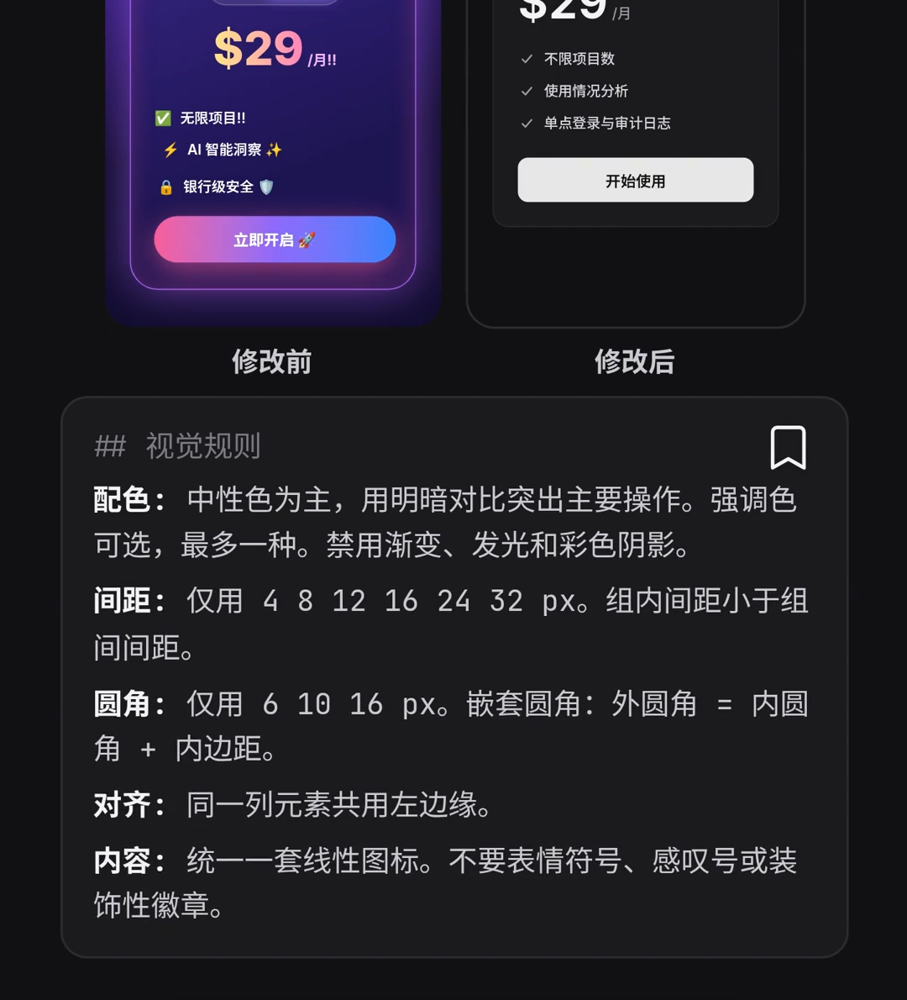
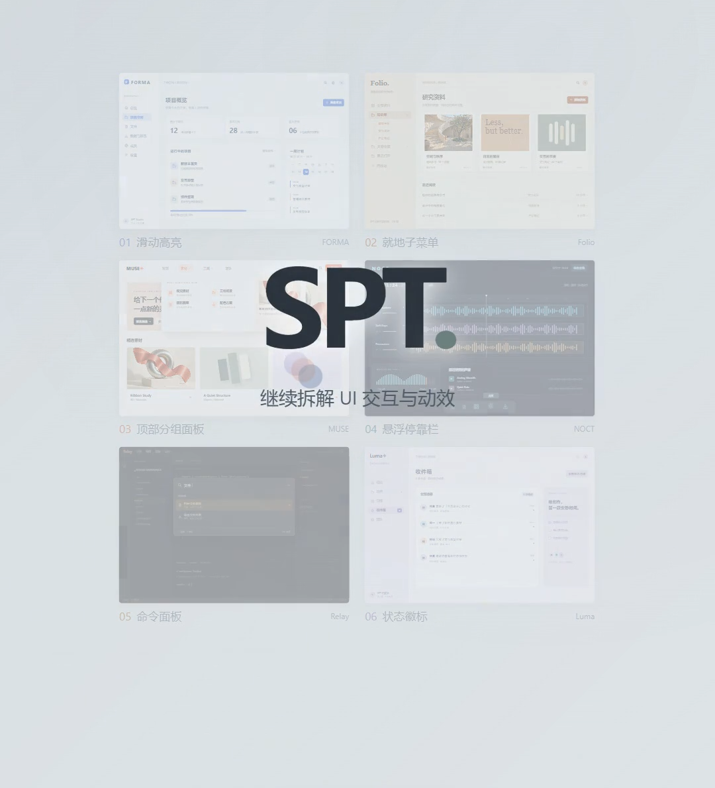
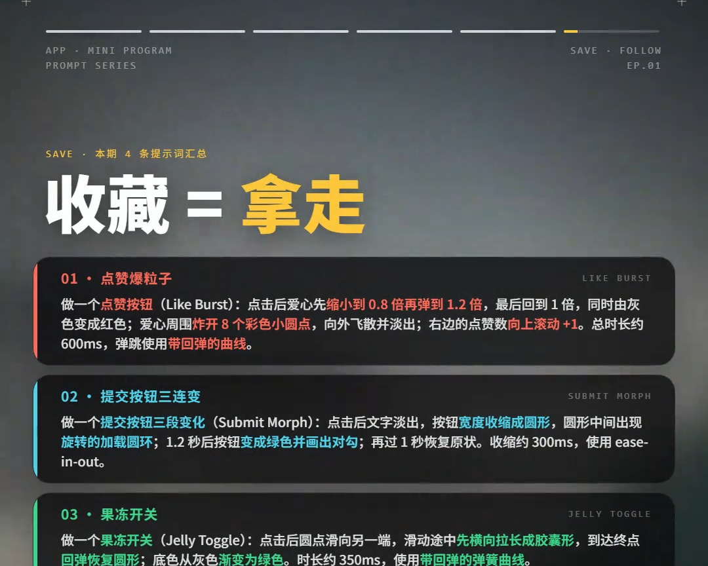
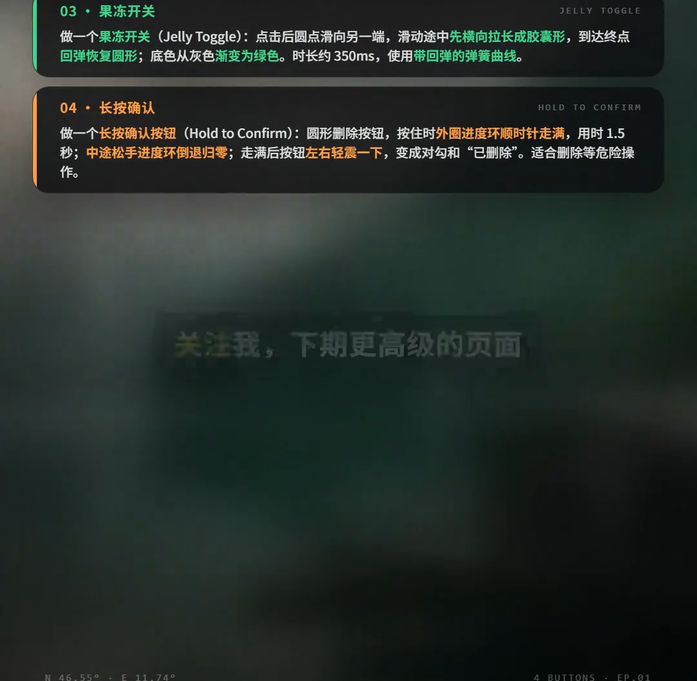

<div align="center">

# ui-motion-playbook

**让 AI 做出"不像 AI 做的"界面**

一套可执行的 UI 动效与交互规范，写成 AI Agent 能直接加载的 skill

[](https://skill.md/)
[](SKILL.md)
[](#来源与置信度)

读 6 个动效教学视频，逐条转写 + 抽帧核对；参数对照 Carbon Design System 官方规范；
**每个数字都能反查到出处。**

</div>

---

## 一句话说清它解决什么

AI 做界面，问题从来不是"动画不够多"，而是**该不该动、动多少、动多久**都说不清。
这个 skill 给的不是效果清单，是一套**判断流程 + 可执行参数 + 硬闸门**。

> 「叫得出名字，AI 才改得对。」

## 它长什么样

<table>
<tr>
<td width="50%"></td>
<td width="50%"></td>
</tr>
<tr>
<td align="center"><sub>视觉规则：配色 / 间距 / 圆角 / 对齐 / 图标</sub></td>
<td align="center"><sub>后台菜单「一次点击，六种回应」</sub></td>
</tr>
<tr>
<td width="50%"></td>
<td width="50%"></td>
</tr>
<tr>
<td align="center"><sub>点赞爆粒子 / 提交三连变</sub></td>
<td align="center"><sub>果冻开关 / 长按确认</sub></td>
</tr>
</table>

## 目录

- [核心方法：动效三问](#核心方法动效三问)
- [三条硬指标](#三条硬指标)
- [视觉规则（可直接抄）](#视觉规则可直接抄)
- [16 种动效一览](#16-种动效一览)
- [安装](#安装)
- [仓库结构](#仓库结构)
- [来源与置信度](#来源与置信度)
- [已知缺口](#已知缺口)

---

## 核心方法：动效三问

加任何动效之前，先过这三问。**三条全否 → 不加。**

| # | 问题 | 例子 |
|:-:|---|---|
| 1 | 是否表达了一次**状态变化**？ | 开→关、加载中→完成、A→B 切换 |
| 2 | 是否**缩短了等待的感知**？ | 骨架屏、进度条、占位块 |
| 3 | 是否提供了**空间定位**？ | 从哪来、到哪去、列表里哪一项 |

这一问能筛掉大部分「AI 味」。剩下那些答对一条以上的，才进入选型和定参。

## 三条硬指标

| 项 | 要求 |
|---|---|
| **时长档位** | 微交互 `90-140ms` · hover/展开 `150-200ms` · 入场 `200-300ms` · 弹窗 `200-260ms` |
| **只动这几个属性** | `transform` / `opacity` / `filter`；必须动高度时用 `grid-template-rows: 0fr → 1fr`，不要 `height: auto` |
| **必须可关** | 全部包进 `@media (prefers-reduced-motion: reduce)` |

超过 `400ms` 的单次动效，必须能说出理由——否则就是装饰。

## 视觉规则（可直接抄）

```markdown
## 视觉规则
配色：中性色为主，用明暗对比突出主要操作。强调色可选，最多一种。禁用渐变、发光和彩色阴影。
间距：仅用 4 8 12 16 24 32 px。组内间距小于组间间距。
圆角：仅用 6 10 16 px。嵌套圆角：外圆角 = 内圆角 + 内边距。
对齐：同一列元素共用左边缘。
内容：统一一套线性图标。不要表情符号、感叹号或装饰性徽章。
```

## 16 种动效一览

| # | 效果 | 一句话 |
|:-:|---|---|
| 01 | 边缘流光 Border Beam | 一道光沿卡片边框跑圈，突出最想让人看到的卡片 |
| 02 | 聚光 Spotlight | 鼠标移动时一团光跟着走 |
| 03 | 3D 倾斜 Tilt | 卡片随指针微微倾斜，像拿在手里转 |
| 04 | 滚动叙事 | 页面滚动时画面固定，内容逐步变化 |
| 05 | 乱码解码 Scramble Text | 字符先乱跳，再逐个定格成正确的字 |
| 06 | 视差滚动 Parallax | 背景比前景动得慢，做出纵深 |
| 07 | 磁吸 Magnetic | 指针靠近时按钮轻微吸附过去 |
| 08 | 打字机 Typewriter | 逐字打出，带闪烁光标 |
| 09 | 跑马灯 Marquee | 内容横向无限循环（少数该**匀速**的动效，hover 要能停） |
| 10 | 流光 Shimmer | 一道光扫过，用于骨架屏和按钮 |
| 11 | 数字滚动 Count Up | 数字从 0 滚到目标值 |
| 12 | 滚动出现 Scroll Reveal | 进入视口才淡入/滑入 |
| 13 | 弹性 Spring | 到终点冲过头一点再弹回 |
| 14 | 错峰 Stagger | 依次出现，**每项间隔 0.05s** |
| 15 | 悬停上浮 Hover Lift | 微微浮起 + 阴影变深，提示可点 |
| 16 | 缓动 Easing | 进场减速，**离场比进场更快更轻** |

另附：**6 种遮罩层**（按打断程度递增选）、**5 种加载形态**、**后台菜单 6 种回应**。

## 安装

### WorkBuddy

```bash
cp -r ui-motion-playbook ~/.workbuddy/skills/
```

调用 `/ui-motion-playbook`，或说「给这个页面加点动效」时自动触发。

### Claude Code（原生支持，零改造）

```bash
cp -r ui-motion-playbook ~/.claude/skills/          # 个人级，所有项目可用
cp -r ui-motion-playbook <项目>/.claude/skills/      # 项目级，可提交共享
```

### Codex

```bash
mkdir -p ~/.codex/prompts
cp adapters/codex/prompts/ui-motion.md ~/.codex/prompts/
# 重启 Codex，输入 /ui-motion
```

想让规则常驻：把 `adapters/codex/AGENTS.md.snippet` 追加到项目根 `AGENTS.md`。

### Cursor / Cline

```bash
cp adapters/.cursor/rules/ui-motion.mdc <项目>/.cursor/rules/
cp adapters/.clinerules/ui-motion.md    <项目>/.clinerules/
```

各工具细节见 [`adapters/README.md`](adapters/README.md)。

## 仓库结构

```
ui-motion-playbook/
├── SKILL.md                    入口：六步工作流 + 触发词
├── references/
│   ├── effects-catalog.md      16 种动效 / 6 种遮罩层 / 5 种加载形态
│   ├── motion-spec.md          来源与置信度、时长与缓动表、四条按钮提示词原文
│   ├── ai-prompting.md         「跟 AI 说」句式库、反模式对照
│   ├── review-checklist.md     视觉规则原文、去 AI 味四条、三层自检
│   ├── admin-navigation.md     后台菜单六种回应 + 滑动高亮块实现
│   └── transcripts.md          6 份完整转写稿（未删改，带时间戳）
├── assets/                     4 张原始截图
└── adapters/                   WorkBuddy / Claude Code / Codex / Cursor / Cline
```

## 来源与置信度

| 来源 | 贡献了什么 | 置信度 |
|---|---|:-:|
| 6 条动效教学视频（转写 + 抽帧核对） | 效果清单、判据、口诀、四条按钮提示词原文 | 高（原话） |
| [Carbon Design System — Motion](https://carbondesignsystem.com/elements/motion/overview/) | 时长令牌 `70/110/150/240/400/700ms`、三条缓动曲线 | 高（官方规范） |
| 标注 `≈` 的区间 | 骨架屏周期、跑马灯速度、加载条周期 | 低（经验值，可调） |

所有数字在 [`references/motion-spec.md`](references/motion-spec.md) 的「来源与置信度」表可反查；
原话在 [`references/transcripts.md`](references/transcripts.md)。

## 已知缺口

第 7 个视频「想要做加载动画怎么跟 AI 说」的源文件始终没拿到，
所以**加载动画那一节是通用做法补充，不是原话**。文件里已标注。

---

<div align="center">
<sub>内容整理自公开教学视频，仅供学习参考</sub>
</div>
